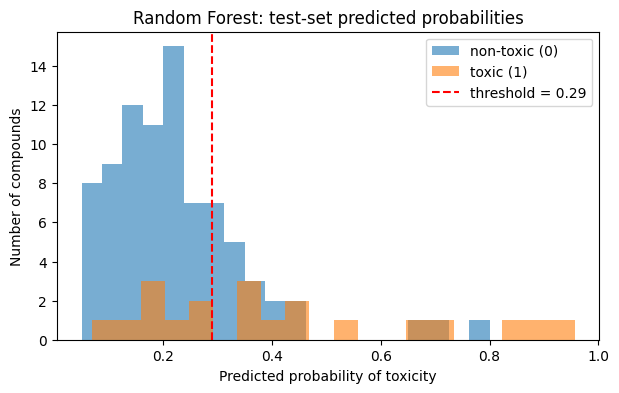

# Toxicity Prediction of Food Contaminants (ApisTox)

Predicting whether a pesticide is toxic to honey bees (*Apis mellifera*) from its molecular structure. Pesticide residues are a food-safety concern, so an early screening tool can help prioritise compounds for further testing.

## Problem

Pesticides are a major source of contamination in food and the environment. Testing every compound for toxicity is slow and expensive. A model that predicts toxicity from structure can help rank compounds for experimental testing. This is a binary classification problem: toxic (1) or non-toxic (0).

**Important:** the target is toxicity to honey bees, not to humans. The link to food safety is indirect (pesticide residues), so results should be read as a screening signal, not a human health assessment.

## Dataset

ApisTox (UCI Machine Learning Repository): 1,035 pesticides and agrochemicals with SMILES strings and binary toxicity labels.

- Toxic: 296 (29%)
- Non-toxic: 739 (71%)
- All 1,035 SMILES were parsed by RDKit, none removed.

## Method

1. **Scaffold split (80:10:10):** compounds sharing a Murcko scaffold are placed in the same split. Split sizes: train 828, validation 103, test 104.
2. **Random Forest (main model):** Morgan fingerprints (radius 2, 2048 bits), `class_weight="balanced"`, 300 trees. Three random seeds.
3. **GNN (comparison):** graph neural network with 7 atom features, two `GCNConv` layers, `global_add_pool`, and a weighted BCE loss (`pos_weight`). Learning rate chosen on validation AUC.
4. **Evaluation:** ROC-AUC on the test set. Test set is used only for the final comparison.
5. **Threshold selection:** the classification threshold was chosen by maximising F1 on the validation set, then applied once to the test set.

## Results

| Model | Test ROC-AUC (mean over seeds) |
|---|---|
| Random Forest (ECFP) | 0.76 (range 0.75–0.77) |
| GNN (7 features) | 0.57 (range 0.49–0.64) |

The Random Forest is the main model. The GNN underperformed, most likely because the dataset is small (828 training compounds) and the atom features are limited.

### Threshold-based evaluation

The threshold was chosen on the validation set (F1 maximisation), then applied once to the test set.

| Metric | Value |
|---|---|
| Threshold (validation) | 0.29 |
| Validation F1 | 0.54 |
| Test F1 | 0.47 |
| Test precision | 0.39 |
| Test recall | 0.60 |

A trivial classifier predicting every compound as toxic would reach F1 ≈ 0.32 on this test set, so the model is better than chance, but the test set is small (20 toxic compounds).

Toxic compounds are concentrated at higher predicted probabilities, but several toxic compounds receive low scores and overlap with the non-toxic distribution.

## Limitations

- **Small test set:** only 20 toxic compounds in the test split, so the AUC and F1 estimates are uncertain.
- **Imbalanced splits:** the scaffold split puts fewer toxic compounds in validation (20%) and test (19%) than in the full data (29%).
- **Single target:** toxicity to honey bees only. Human or other species toxicity is not modelled.
- **Limited features:** Morgan fingerprints capture local structure, not 3D shape or metabolism.
- **Threshold sensitivity:** F1 depends on the chosen threshold. A different validation split could select a different value.
- **Precision–recall trade-off:** recall (0.60) is prioritised over precision (0.39), which suits screening but produces false alarms.

## How to run

1. Open `Toxicity_Prediction_of_Food_Contaminants_v2.ipynb` in Google Colab.
2. Run **Runtime → Restart and run all**. The first cell installs the required packages.
3. The data is loaded from the GitHub raw URL.

## Repository contents

- `Toxicity_Prediction_of_Food_Contaminants_v2.ipynb`: full analysis
- `toxicity_probability_plot.png`: predicted probability distribution (saved by the notebook)
- `README.md`: this file

## Tools

Python, RDKit, scikit-learn, PyTorch, PyTorch Geometric, Pandas, NumPy, Matplotlib

## Data source

ApisTox: Adamczyk, J., Poziemski, J., & Siedlecki, P. (2024). ApisTox [Dataset]. UCI Machine Learning Repository. https://doi.org/10.5281/zenodo.11062076
